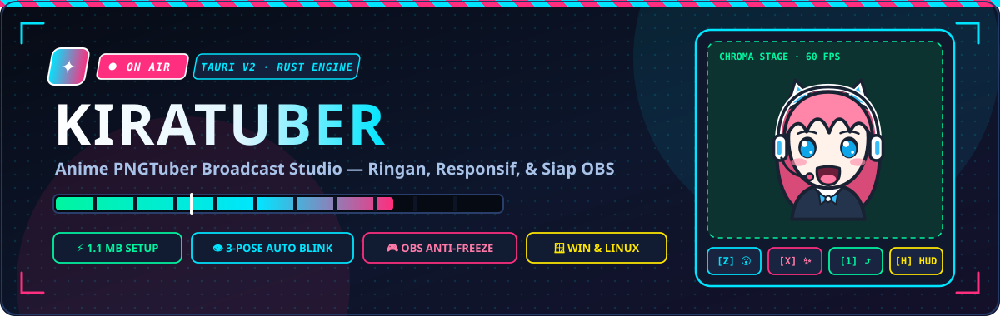
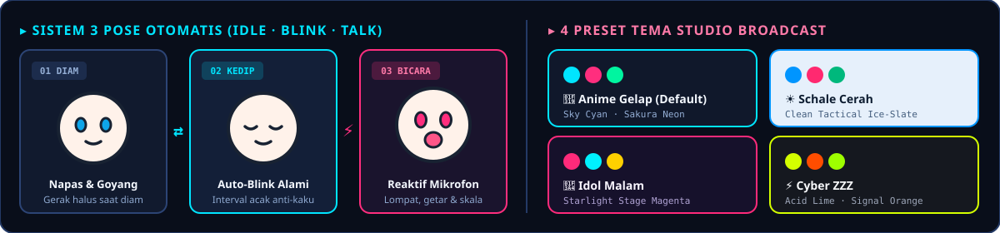

<div align="center">



<br>

[](https://github.com/SusantiYanto/KiraTuber/releases/latest)
[](https://github.com/SusantiYanto/KiraTuber/releases/latest)
[](https://v2.tauri.app/)
[](https://github.com/SusantiYanto/KiraTuber/releases/latest)
[](LICENSE)

<p>
  <strong>Aplikasi Studio PNGTuber 2D super ringan bergaya Anime Broadcast HUD untuk OBS Studio, Discord, YouTube, &amp; Twitch.</strong><br>
  Tanpa <em>tracking</em> kamera berat — cukup gunakan mikrofon, unggah ilustrasi PNG/WebP, dan siaran langsung dengan 60 FPS mulus.
</p>

<p>
  <a href="https://github.com/SusantiYanto/KiraTuber/releases/latest"><strong>⬇ Unduh KiraTuber Terbaru</strong></a> ·
  <a href="#-fitur-unggulan"><strong>✦ Fitur Unggulan</strong></a> ·
  <a href="#-panduan-obs-studio--discord"><strong>🎥 Panduan OBS</strong></a> ·
  <a href="#-pintasan-keyboard-bawaan"><strong>⌨️ Hotkey</strong></a> ·
  <a href="#-membangun-dari-kode-sumber"><strong>🛠️ Build Source</strong></a>
</p>

</div>

---

## ✦ Sekilas Alur Kerja &amp; Tema Studio

<p align="center">
  
</p>

---

## 🚀 Fitur Unggulan

| Kategori | Keunggulan Utama |
| :--- | :--- |
| **⚡ Super Ringan (Rust + Tauri v2)** | Ukuran *installer* hanya **~1.1 MB** (*portable* **~3 MB**), animasi berbasis komposisi GPU (`translate3d` &amp; `scaleX`) tanpa *library* berat, hemat CPU &amp; RAM saat bermain *game* berat. |
| **👁️ Sistem 3 Pose (`Diam` · `Kedip` · `Bicara`)** | Dilengkapi **Auto-Blink alami** (interval &amp; durasi dapat diatur + jeda waktu acak anti-kaku &amp; *double-blink* sesekali) serta gerakan napas dan goyang kiri-kanan halus saat karakter diam. |
| **🎮 Anti-Freeze di OBS Saat Main Game** | Dioptimalkan khusus agar animasi karakter **tidak membeku di OBS Window Capture** meskipun jendela KiraTuber tertutup oleh *game fullscreen*. |
| **🎙️ Deteksi Suara Presisi + Kalibrasi 2 Detik** | Indikator VU Meter *real-time*, *Noise Gate*, *Noise Reduction* mikrofon, serta tombol **Kalibrasi Noise Otomatis** cukup dengan diam selama 2 detik. |
| **✨ Dek Ekspresi &amp; 9 Gerakan Spesial** | 6 slot ekspresi instan dengan ikon emoji kustom + 9 efek gerakan panggung (*Lompat*, *Goyang*, *Putar 2x*, *Pop*, *Gemetar*, *Menunduk*, *Melayang*, *Flash*, *Menari*) lengkap dengan *hotkey* bebas atur. |
| **🖼️ Editor Foto Crop &amp; Rotasi Bawaan** | Potong rasio (`1:1`, `4:3`, `16:9`, potret, atau bebas) dan putar sudut gambar langsung di dalam aplikasi sebelum disimpan otomatis ke perangkat. |
| **🎨 4 Tema Anime Broadcast + 2 Bahasa** | Tersedia 4 tema studio (*Anime Gelap*, *Schale Cerah*, *Idol Malam*, *Cyber ZZZ*) serta dukungan penuh **Bahasa Indonesia** &amp; **English**. |

---

## 📦 Unduh Paket Instalasi

Unduh berkas siap pakai pada halaman [**GitHub Releases**](https://github.com/SusantiYanto/KiraTuber/releases/latest):

### 🪟 Windows (Windows 10 &amp; Windows 11)
| Paket | Berkas | Keterangan |
| :--- | :--- | :--- |
| **Installer Utama (Rekomendasi)** | `KiraTuber_0.1.0_windows_x64-setup.exe` | Setup NSIS 64-bit ringan &amp; praktis (`1.12 MB`) |
| **Windows MSI (64-bit)** | `KiraTuber_0.1.0_windows_x64.msi` | Paket instalasi standar MSI (`1.59 MB`) |
| **Portable 64-bit** | `KiraTuber_0.1.0_windows_x64_portable.exe` / `.zip` | Langsung jalan tanpa instalasi |
| **Windows 32-bit (`x86`)** | `KiraTuber_0.1.0_windows_x86-setup.exe` / `.msi` / `.zip` | Dukungan penuh untuk PC Windows 32-bit |

### 🐧 Linux (`x86_64` / `amd64`)
| Distro / Format | Berkas | Perintah Instalasi / Menjalankan |
| :--- | :--- | :--- |
| **Ubuntu / Debian / Mint / Pop!_OS** | `KiraTuber_0.1.0_linux_amd64.deb` | `sudo apt install ./KiraTuber_0.1.0_linux_amd64.deb` |
| **Fedora / RHEL / openSUSE** | `KiraTuber_0.1.0_linux_x86_64.rpm` | `sudo dnf install ./KiraTuber_0.1.0_linux_x86_64.rpm` |
| **Universal Linux (AppImage)** | `KiraTuber_0.1.0_linux_amd64.AppImage` | `chmod +x KiraTuber_*.AppImage && ./KiraTuber_*.AppImage` |
| **Portable Tarball** | `KiraTuber_0.1.0_linux_x64_portable.tar.gz` | `tar -xzf KiraTuber_*_portable.tar.gz && ./KiraTuber-*/kiratuber` |

---

## 🎥 Panduan OBS Studio &amp; Discord

### Menampilkan Karakter Tanpa Latar di OBS Studio
1. Buka **KiraTuber**, pilih mikrofon di tab **🎙️ Suara &amp; Gerak**, lalu klik **Mulai mikrofon**.
2. Buka tab **⚙️ Layar &amp; App**, pilih latar **Hijau murni (pas untuk OBS)** atau **Transparan (tanpa latar)**.
3. Tekan tombol **`H`** (atau klik ikon **`⇥`** di kanan atas) untuk menyembunyikan panel kontrol — panggung akan bersih 100% tanpa bayangan tepi.
4. Di **OBS Studio**:
   - Tambahkan **Sources → Window Capture** → pilih jendela **`[kiratuber.exe]: KiraTuber`**.
   - Jika memakai latar hijau: klik kanan *source* → **Filters → `+` Chroma Key** (*Key Color Type: Green*).
   - Jika memakai latar transparan: centang opsi *Allow Transparency* pada sumber tangkapan yang mendukung transparansi.

### Memakai Karakter sebagai Kamera di Discord / Zoom / Meet
1. Siapkan tampilan karakter di **OBS Studio** seperti langkah di atas.
2. Klik **Start Virtual Camera** di OBS Studio.
3. Di **Discord → User Settings → Voice &amp; Video → Camera**, pilih **OBS Virtual Camera**.

---

## ⌨️ Pintasan Keyboard Bawaan

Semua *hotkey* di bawah ini dapat diganti sesuka hati cukup dengan mengeklik tombol *keycap* di sebelah pengaturannya:

| Tombol Bawaan | Fungsi |
| :---: | :--- |
| `H` | Sembunyikan / tampilkan panel studio (mode bersih untuk OBS) |
| `Q` `W` `E` `R` | Ganti cepat karakter aktif (Slot Karakter 1 – 4) |
| `Z` `X` `C` `V` `B` `N` | Aktifkan / matikan Ekspresi 1 – 6 |
| `1` – `9` | Jalankan Gerakan Spesial 1 – 9 (*Lompat*, *Goyang*, *Putar*, *Menari*, dll.) |
| `Ctrl + O` | **Kembali normal** (hentikan ekspresi &amp; gerakan spesial seketika) |

---

## 🛠️ Membangun dari Kode Sumber

### Struktur Proyek
```text
KiraTuber/
├── src/
│   └── index.html          # Seluruh UI, engine audio WebAudio, & animasi 60FPS (zero external deps)
├── src-tauri/
│   ├── src/main.rs         # Backend Rust Tauri v2 (kontrol jendela Win32 DWM & izin mikrofon)
│   ├── capabilities/       # Konfigurasi izin keamanan jendela Tauri v2
│   └── tauri.conf.json     # Konfigurasi jendela transparan, ikon, & bundel aplikasi
├── docs/                   # Aset ilustrasi & pratinjau dokumentasi
└── DESIGN.md               # Dokumentasi sistem desain Anime Broadcast HUD
```

### Prasyarat &amp; Perintah Build
1. Pasang [Node.js](https://nodejs.org/) (v20+) dan [Rust](https://rustup.rs/).
   - **Windows:** Pastikan *Microsoft C++ Build Tools* &amp; *WebView2* terpasang.
   - **Linux (Debian/Ubuntu):**
     ```bash
     sudo apt update
     sudo apt install -y libwebkit2gtk-4.1-dev build-essential curl wget file libxdo-dev libssl-dev libayatana-appindicator3-dev librsvg2-dev patchelf
     ```
2. Jalankan mode pengembangan atau buat paket rilis:
   ```bash
   npm install
   npm run dev     # Menjalankan mode pengembangan
   npm run build   # Membuat paket rilis produksi
   ```

---

<details>
<summary><strong>🌐 English Overview &amp; Quick Start (Click to Expand)</strong></summary>

<br>

**KiraTuber** is an ultra-lightweight, zero-bloat 2D **Anime PNGTuber Broadcast Studio** built with **Rust** and **Tauri v2**. Designed for VTubers, gamers, and streamers who want a responsive voice-reactive avatar without heavy webcam face-tracking CPU/GPU overhead.

### Key Highlights
- **Tiny Footprint:** ~1.1 MB installer, GPU-composited 60 FPS animations, and single-transaction IndexedDB asset storage.
- **3-Pose Avatar Engine:** Supports **Idle**, **Auto-Blink** (with natural non-robotic random intervals &amp; occasional double-blinks), and **Talking** sprites, plus smooth idle breathing and left-right sway.
- **OBS Fullscreen Game Anti-Freeze:** Configured to keep animating smoothly in OBS Window Capture even when occluded behind fullscreen games.
- **Stream-Deck Style Emotes &amp; Motions:** 6 custom-icon expression slots + 9 procedural stage motions triggered by customizable hotkeys.
- **Full English Support:** Switch the entire UI to **English** anytime under **⚙️ Stage &amp; App → Theme &amp; language**.

</details>

---

<div align="center">
  <sub>Dibuat dengan ✦ menggunakan <strong>Rust &amp; Tauri v2</strong> · Dirilis di bawah <a href="LICENSE">Lisensi MIT</a></sub>
</div>
